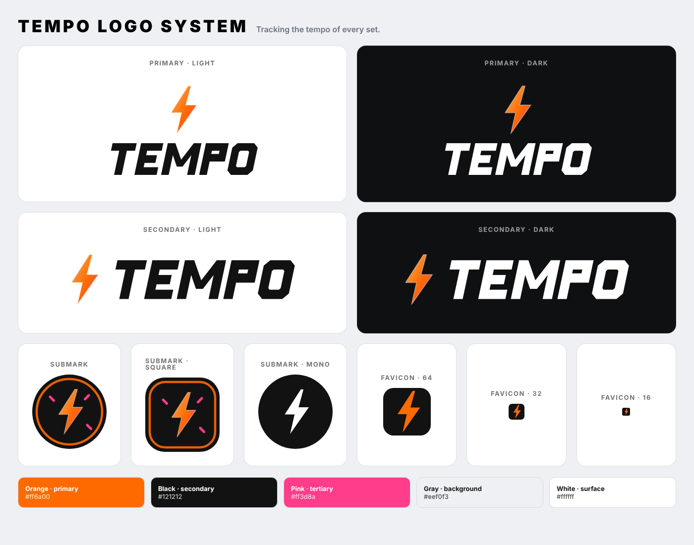

# Tempo brand

**Motto:** Tracking the tempo of every set.

The mark is an orange lightning bolt — the gradient runs from light orange through the brand orange to a pink tip. The wordmark is a custom geometric italic (vector paths, no font needed).

## The four logos

| Logo | Use it for | Files | In the app |
| --- | --- | --- | --- |
| **Primary** — bolt stacked above the wordmark | Home hero, splash screens, square or tall placements, anything where the logo is the focus | `public/brand/tempo-primary.svg` (black wordmark), `tempo-primary-white.svg` (for dark backgrounds), `tempo-primary-on-black.svg` | `<LogoPrimary width motto />` or `<Logo size="lg|xl" />` |
| **Secondary** — bolt beside the wordmark | Page headers, documents, wide/short placements where the primary would be too tall | `public/brand/tempo-secondary.svg`, `tempo-secondary-white.svg`, `tempo-secondary-on-black.svg` | `<LogoSecondary height motto />` or `<Logo size="sm|md" />` |
| **Submark** — bolt in a black circle with an orange ring and pink sparks | Top bars, avatars, social profile pictures, watermarks, stickers | `public/brand/tempo-submark.svg` (circle), `tempo-submark-square.svg` (rounded square), `tempo-submark-mono.svg` (one-colour) | `<Submark size shape="circle|square" />` (`<LogoMark>` is the square submark used by the top bar) |
| **Favicon** — solid orange bolt on a black rounded square, no gradient or sparks | Browser tab, PWA / home-screen icon, anything 16–64 px | `public/favicon.svg`, `public/brand/tempo-favicon.svg`, PNGs in `public/icons/` | `index.html`, `manifest.webmanifest` |

PNG exports live in `public/brand/png/` (primary 1200 px, secondary 1600 px, submarks 512 px, favicon 256/32 px). Regenerate everything with `npm run brand` (and `npm run icons` for the PWA icon set) after editing `scripts/make-brand.mjs` or `src/components/Logo.tsx` — both share the same geometry and must be kept in sync.

## Colours

| Role | Hex | Use |
| --- | --- | --- |
| Orange (primary) | `#ff6a00` | Main highlight: primary buttons, active states, Team A, the bolt |
| Black (secondary) | `#121212` | Secondary buttons, wordmark on light backgrounds, submark background |
| Pink (tertiary) | `#ff3d8a` | Accents: Team B, hit markers, badges, the bolt's tip and sparks |
| Gray | `#eef0f3` | App background |
| White | `#ffffff` | Surfaces (cards, bars, wordmark on dark backgrounds) |

Dark mode keeps orange and pink, flips the wordmark to white and the backgrounds to near-black (`#0f1012` / `#1a1b1e`).

## Rules of thumb

- Keep clear space around every logo of at least the bolt's width.
- Never recolour the bolt, stretch the wordmark, or put the primary logo on orange or pink (use the submark or the mono submark there).
- Minimum sizes: primary 120 px wide, secondary 24 px tall, submark 24 px, favicon 16 px.
